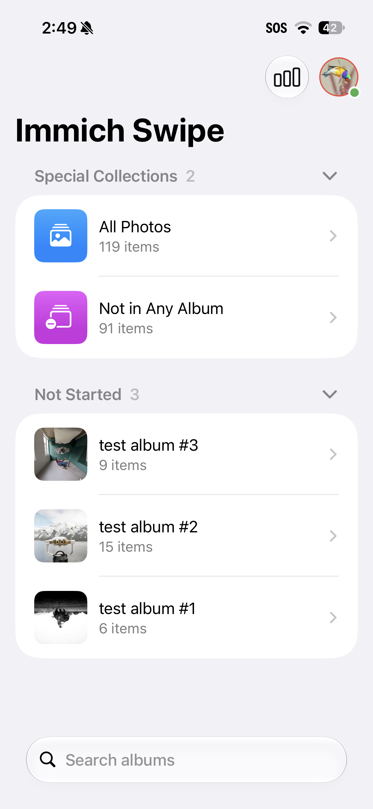
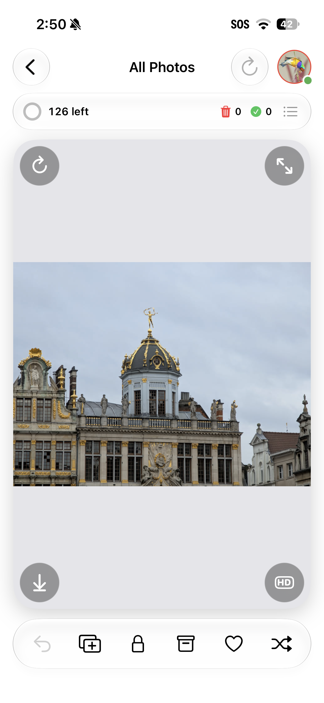
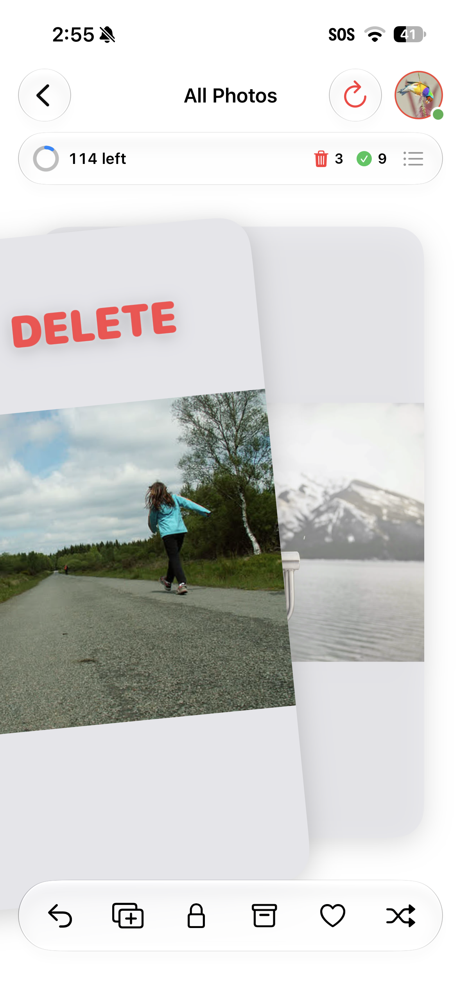
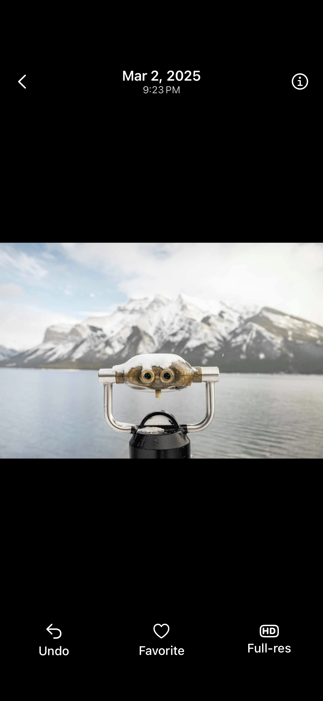
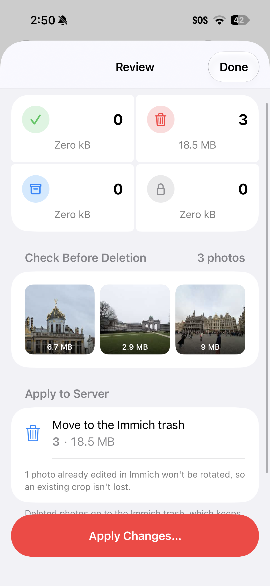
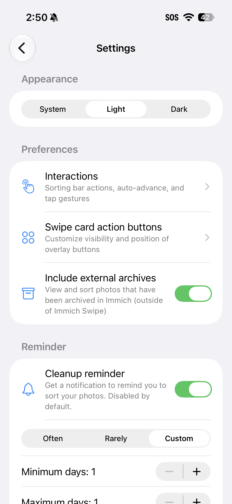

# Immich Swipe for iOS


[Privacy Policy](PRIVACY_POLICY.md)

Immich Swipe is an open-source iPhone and iPad app that makes sorting the photos and videos on your
[Immich](https://immich.app/) server quick and easy.

It is a native SwiftUI port of the Android app
[markvoronin354/immich-swipe-apk](https://github.com/markvoronin354/immich-swipe-apk), which is itself a
fork of [Minos2020/immich-swipe-android](https://github.com/Minos2020/immich-swipe-android).

> **Disclaimer**: This is an independent project and is not affiliated in any way with the official Immich project.

## 📸 Overview

|                      Home Screen                       |                      Sorting Stack                      |                         Swipe to Delete                          |
|:------------------------------------------------------:|:-------------------------------------------------------:|:----------------------------------------------------------------:|
|         |         |           |
|                 *Browse your albums*                   |                   *Swipe to decide*                     |                    *Left to delete, right to keep*               |

|                       Full Screen                       |                      Review Mode                       |                       Settings                        |
|:-------------------------------------------------------:|:------------------------------------------------------:|:-----------------------------------------------------:|
|    |       |    |
|                   *Zoom in on details*                  |                *Check before deleting*                 |                 *Make it your own*                    |

## ✨ Features

- **🚀 Fast Sorting Stack**: Swipe right to keep, left to delete, or up for customizable actions (Archive, Favorite, Lock, Add to Album).
- **👯 Duplicates Finder & Cleanup**: Find and resolve duplicate photo clusters with side-by-side comparison, zoom and video playback.
- **📁 Collections**: Sort special groups such as **All**, **Orphans** (photos not in any album) and **Duplicates**.
- **📊 Usage Statistics**: See your progress and a breakdown of your decisions.
- **🛡️ Review Mode**: Check every decision and the estimated space you'll reclaim before applying changes to Immich.
- **⚙️ Customizable Actions**: Configure action buttons, swipe gestures, haptics, auto-advance and video autoplay.
- **🔄 Multiple Accounts**: Switch between Immich accounts, each with its own local progress.
- **🗃️ Backup & Cache**: Export, import or reset your local decisions (JSON, compatible with Android backups) and clear caches.
- **🚦 Diagnostics**: Connection status, HTTP/IP server support and an in-app log viewer.

## ⚙️ Setup

1. Enter your Immich server URL (for example `https://immich.your-domain.com` or `http://10.0.0.10:2283`).
2. Enter an Immich API key ([create one in Immich under User Settings › API Keys](https://my.immich.app/user-settings?isOpen=api-keys)).
3. Pick an album or collection and start sorting.

### 🔐 API key permissions

Following the principle of least privilege, give the API key only these permissions:

- `asset.read`
- `asset.statistics`
- `asset.download`
- `asset.update`
- `asset.edit.create`
- `asset.delete`
- `asset.view`
- `album.create`
- `album.read`
- `album.update`
- `albumAsset.create`
- `albumAsset.delete`
- `duplicate.read`
- `user.read`
- `userProfileImage.read`

## 🛠️ Build

- Xcode 27 or later, iOS/iPadOS 27.2 or later.
- Open `Immich Swipe iOS.xcodeproj`, choose the **MyApp** scheme and run.
- To sign for a device, set your own team under *Signing & Capabilities*.
- Tests use Swift Testing:

  ```sh
  xcodebuild build -scheme MyApp -destination 'platform=iOS Simulator,name=iPhone 17'
  xcodebuild test -scheme MyAppTests -destination 'platform=iOS Simulator,name=iPhone 17'
  ```

## 📄 License

This project is licensed under the GNU GPL v3. See the [LICENSE](LICENSE) file for details.
